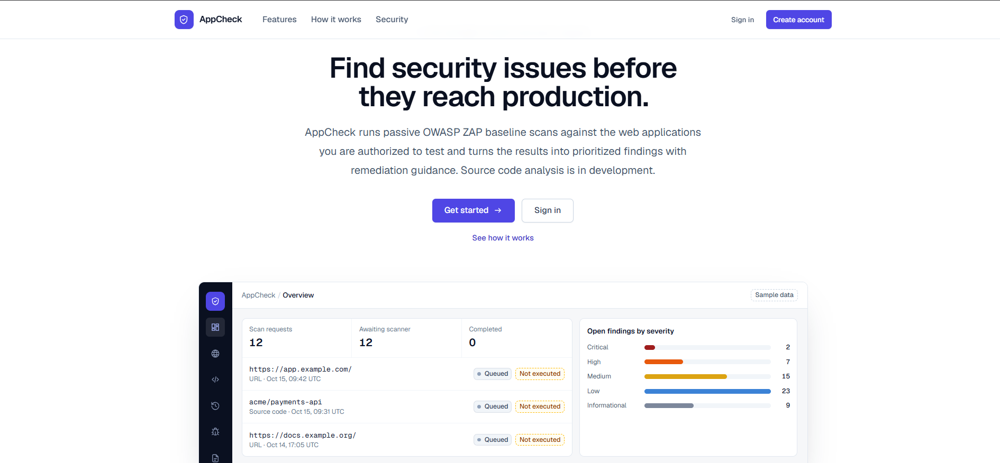
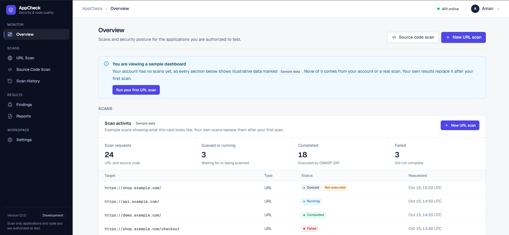
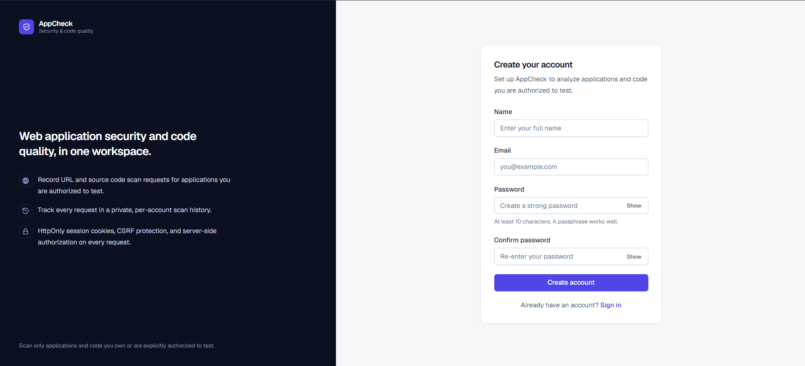
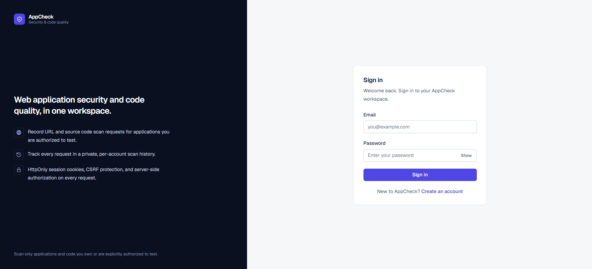
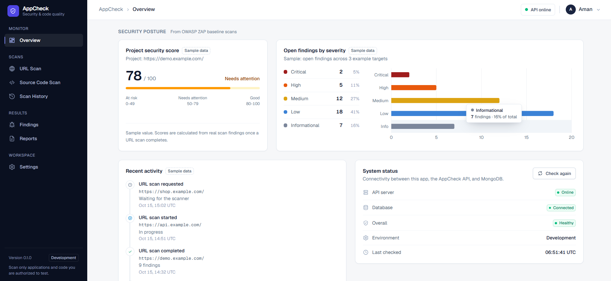
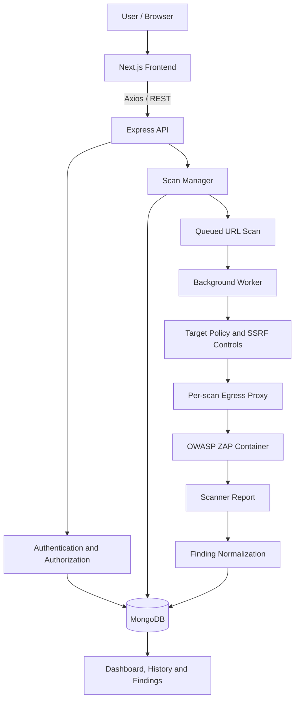
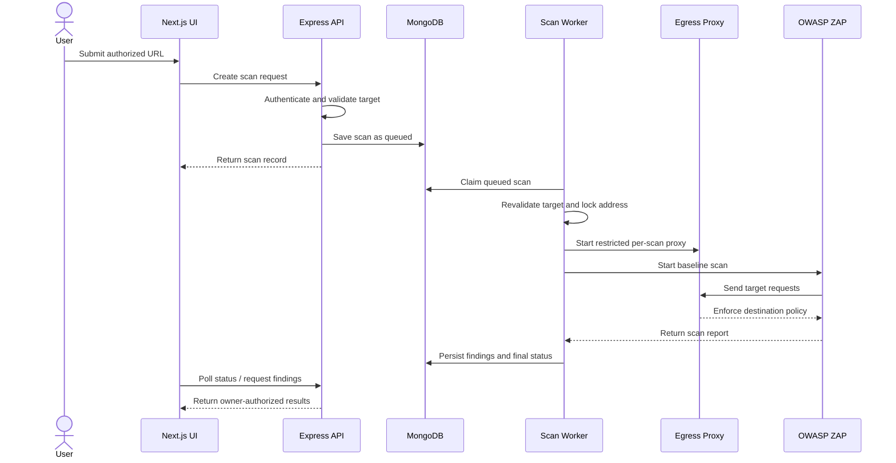

<div align="center">

# AppCheck

### Web Application Security & Code Quality Analyzer

A developer-focused workspace for managing security scans, reviewing findings, and tracking application risk.



**[Overview](#overview) · [Features](#features) · [Architecture](#architecture) · [Getting Started](#getting-started) · [Security](#security--responsible-use) · [Project Status](#project-status)**

</div>

---

## Overview

Modern applications depend on frameworks, APIs, authentication systems, configuration, and third-party packages. A vulnerable dependency, exposed secret, or insecure configuration can introduce security risks.

**AppCheck** is a full-stack application-security project designed to bring authorized web application scanning and source-code analysis into one workspace. It includes account authentication, scan management, scan history, finding persistence, and a dashboard for reviewing results.

> **Current status:** The URL-scanning workflow and OWASP ZAP Docker runner are implemented in code, but real ZAP execution has not yet been verified on the development machine. Existing scanner tests use mocked ZAP execution. End-to-end source-code scanning is planned and is not currently available.

## Screenshots

<table>
  <tr>
    <td align="center" width="50%">
      <strong>Public Landing Page</strong><br><br>
      
    </td>
    <td align="center" width="50%">
      <strong>Dashboard Overview</strong><br><br>
      
    </td>
  </tr>
  <tr>
    <td align="center" width="50%">
      <strong>Create Account</strong><br><br>
      
    </td>
    <td align="center" width="50%">
      <strong>Sign In</strong><br><br>
      
    </td>
  </tr>
  <tr>
    <td align="center" colspan="2">
      <strong>Security Posture & System Status</strong><br><br>
      
    </td>
  </tr>
</table>

> Dashboard security scores and severity counts shown as sample data are illustrative. They must not be interpreted as results from a real scan.

## Features

### Application features

- **Authentication:** registration, sign-in, protected routes, password hashing, and session-cookie protections.
- **Scan management:** create and track URL-scan requests and source-scan request records.
- **Scan lifecycle:** queued, running, completed, and failed states in the URL-scanning workflow.
- **Scan history:** review your own scan records, statuses, finding counts, and available results.
- **Findings:** persist normalized URL-scan findings and restrict access to the scan owner.
- **Dashboard:** view live scan counts and recent activity. Sample security-posture data is labeled until a real scan completes.
- **Security controls:** request validation, authentication and ownership checks, rate limiting, secure HTTP headers, and structured logging.
- **Responsive interface:** public landing page, authentication screens, dashboard, scan pages, and responsive navigation.

### Scanner capability status

| Capability | Current status |
|---|---|
| Scan-request and history APIs | Implemented |
| URL validation and SSRF safeguards | Implemented in code; continued verification required |
| Background URL-scan worker | Implemented |
| OWASP ZAP Docker runner | Implemented in code; real execution not yet verified |
| ZAP report normalization and finding persistence | Implemented for scanner reports |
| Source-code ZIP scanning | Planned; not end-to-end implemented |
| Semgrep, Gitleaks, npm audit, OSV-Scanner pipeline | Planned |
| Production hardening | Pending real-scanner validation and security review |

## Technology Stack

| Area | Technologies |
|---|---|
| Frontend | Next.js App Router, React, JavaScript, Redux Toolkit, React Hook Form, Axios, Tailwind CSS, Recharts, TanStack Table |
| Backend | Node.js, Express.js, JavaScript REST API |
| Database | MongoDB, Mongoose, MongoDB Atlas |
| Authentication and security | JWT, bcrypt, Helmet, CORS, express-rate-limit, Zod |
| Logging | Pino |
| URL scanner | OWASP ZAP Docker integration (real execution pending validation) |
| Planned source scanners | Semgrep, Gitleaks, npm audit, OSV-Scanner |
| Development tools | Git, GitHub, Postman, Docker, VS Code |

## Architecture



The frontend communicates with the Express API. The API validates requests, enforces authentication and ownership, records scan jobs, and persists results in MongoDB. The URL worker is designed to run a ZAP baseline scan through a restricted egress proxy and normalize the report into findings.

**Validation note:** The real ZAP-to-proxy network path has not yet been verified with a live scan. The architecture diagram describes the intended code flow, not proof of successful live execution.

## URL Scan Flow



### Scan states

| State | Meaning |
|---|---|
| `queued` | The scan request is stored and waiting for a worker. |
| `running` | The worker has claimed the job and is executing it. |
| `completed` | Scanner execution and result processing finished successfully. |
| `failed` | Validation, execution, timeout, or result processing failed. |

A scan must not be marked `completed` unless scanner results were actually produced and processed.

## Getting Started

### Prerequisites

- Git
- Node.js LTS and npm
- MongoDB Atlas or another accessible MongoDB instance
- Docker Desktop with its engine running for real ZAP execution
- WSL 2 for supported Windows installations using Docker Desktop's WSL 2 backend

Without Docker and a verified ZAP run, you can work on the application UI and APIs, but the scanner is not validated end to end.

### 1. Clone the repository

```bash
git clone <YOUR_GITHUB_REPOSITORY_URL>
cd appcheck
```

Replace `<YOUR_GITHUB_REPOSITORY_URL>` with your actual GitHub repository URL.

### 2. Install dependencies

Open one terminal for the backend:

```bash
cd backend
npm install
```

Open a second terminal for the frontend:

```bash
cd frontend
npm install
```

### 3. Configure the backend environment

Create `backend/.env` using `backend/.env.example` as the source of truth. A typical local configuration includes:

```dotenv
NODE_ENV=development
PORT=5000
FRONTEND_URL=http://localhost:3000
MONGODB_URI=mongodb+srv://<username>:<password>@<cluster>/<database>
JWT_SECRET=<long-random-secret>
URL_SCANNER=disabled
```

The exact required variables may differ. Check `backend/src/config/env.js` and `backend/.env.example` and include all required settings.

**Never commit `.env` files or publish database credentials, JWT secrets, API keys, or cookies.**

### 4. Configure the frontend environment

Create `frontend/.env.local`:

```dotenv
NEXT_PUBLIC_API_URL=http://localhost:5000/api/v1
```

Restart the Next.js dev server after changing environment variables.

### 5. Configure MongoDB Atlas

1. Create or select a MongoDB Atlas project and cluster.
2. Create a database user with a strong password.
3. Add your current development IP in **Network Access**.
4. Put the connection string in `backend/.env` and specify the intended database.
5. Keep the connection string private.

If the connection fails, verify the Atlas IP allowlist, database credentials, connection string, and local network/DNS configuration.

### 6. Start the backend

From the `backend` directory, use the script defined by `backend/package.json`. If `npm run dev` is configured:

```bash
npm run dev
```

Otherwise, use the repository's documented server command.

Check the health endpoint:

```text
http://localhost:5000/api/v1/health
```

Confirm the API is running and the database reports as connected before testing authenticated features.

### 7. Start the frontend

From the `frontend` directory:

```bash
npm run dev
```

Open [http://localhost:3000](http://localhost:3000), create an account, and explore the dashboard, URL Scan, Scan History, scan details, Findings, Reports, and Settings.

### 8. Enable and validate real ZAP scanning

**Keep `URL_SCANNER` disabled until Docker is available and the proxy-boundary checks pass.**

1. Install Docker Desktop using the [official Windows installation guide](https://docs.docker.com/desktop/setup/install/windows-install/).
2. Start Docker Desktop and verify both the Docker client and server are available:

   ```bash
   docker version
   ```

3. Pull the ZAP image:

   ```bash
   docker pull zaproxy/zap-stable
   ```

4. Follow `docs/DEVELOPMENT.md` for the exact scanner environment variables and local lab target configuration.
5. Run the repository's documented scanner lab check **before** starting a scan.
6. Continue only if the prohibited-destination canary receives zero requests and the required boundary checks pass.
7. Start the documented local training target and scan only that target.
8. Verify the scan produced a genuine ZAP report, findings were persisted, and `proxyStats.requests` is greater than zero.

If a boundary check fails or ZAP bypasses the proxy, disable the scanner. Do not test against public systems or real cloud metadata endpoints.

## Testing

Run the scripts available in each package's `package.json`. Typical commands are:

```bash
# Backend
cd backend
npm test

# Frontend (run from another terminal)
cd frontend
npm run lint
npm run build
```

If a script is not defined, inspect the relevant `package.json` and use the project's configured command.

Mocked scanner tests can validate job processing, report normalization, and error handling. They do **not** prove that a real ZAP container executes successfully or that its traffic is confined to the egress proxy.

## Repository Structure

```text
appcheck/
├── frontend/
│   ├── app/
│   ├── components/
│   ├── features/
│   ├── hooks/
│   ├── lib/
│   ├── services/
│   └── store/
├── backend/
│   └── src/
│       ├── config/
│       ├── controllers/
│       ├── middleware/
│       ├── models/
│       ├── routes/
│       ├── scanner/
│       ├── services/
│       ├── utils/
│       └── validators/
├── docs/
│   ├── images/
│   ├── ARCHITECTURE.md
│   ├── API.md
│   ├── DATABASE.md
│   ├── SECURITY.md
│   └── DEVELOPMENT.md
├── README.md
└── .gitignore
```

This is a high-level guide. Refer to the current repository for the exact structure.

## Security and Responsible Use

AppCheck is intended for development environments, local security testing, and authorized assessments of systems you own or have explicit permission to test.

- Only scan authorized targets.
- Begin with passive baseline checks; aggressive active testing requires separate authorization and a risk review.
- Treat submitted URLs, scanner output, and source archives as untrusted input.
- Keep scanner execution isolated and resource-limited.
- Do not expose secrets found in source code or scanner evidence.
- Verify findings manually before treating them as confirmed vulnerabilities.

Automated scanners can produce false positives and false negatives. AppCheck cannot guarantee that an application is secure. Real ZAP proxy enforcement and isolated Docker networking remain prerequisites before production use.

## Project Status

- [x] Full-stack application foundation and database integration
- [x] Authentication and protected routes
- [x] Scan request management and scan history
- [x] Responsive landing page and dashboard
- [x] URL-scanner worker and report-processing code
- [x] Finding persistence and owner-based access
- [ ] Install Docker/WSL on the development machine
- [ ] Verify a genuine ZAP baseline scan end to end
- [ ] Verify proxy enforcement and isolated scanner networking with real ZAP
- [ ] Implement secure source-code ZIP scanning
- [ ] Integrate Semgrep, Gitleaks, npm audit, and OSV-Scanner
- [ ] Complete reporting and production hardening

## Learning Objectives

This project explores:

- Next.js, React, forms, state management, charts, and tables.
- REST API design, authentication, authorization, validation, and logging.
- MongoDB data modeling and indexing.
- Background jobs and scan-state management.
- Dynamic and static application security testing.
- SSRF prevention, safe process execution, secrets handling, and rate limiting.
- Docker-based tool isolation, automated testing, and deployment.

## License

No license is specified here. Add a `LICENSE` file and update this section before distributing the project or accepting external contributions.

---

<div align="center">

**AppCheck — Security visibility for applications you are authorized to test.**

</div>
